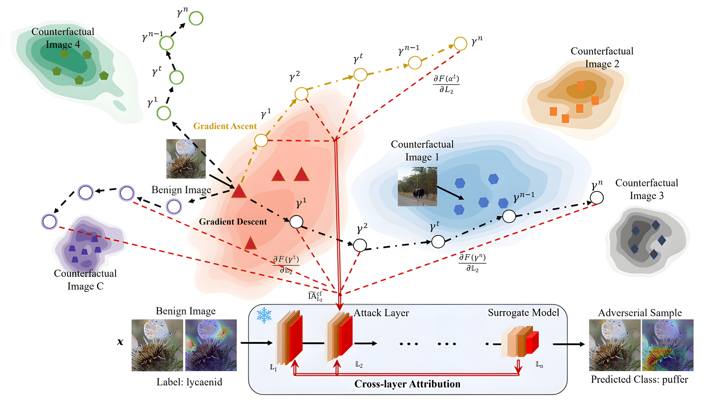

# COPIA

The official implementation of
[**\[ACM MM 2026\] "Counterfactual-Guided Diversified Path Integration for Transferable Neuron Attribution Attacks", Di Ming, Renqing Yang, Yuanchengzhi Liu, Peng Ren, Pengzhan Zhou, Yunlong Wang, and Xin Feng*.**]()


The full paper, including the complete supplementary materials, is available at [ttps://github.com/AdvML-Group/COPIA/blob/main/COPIA_Full.pdf](https://github.com/AdvML-Group/COPIA/blob/main/COPIA_Full.pdf).

## Introduction
Transferable adversarial attacks pose significant security threats to
neural networks due to their strong black-box effectiveness against
real-world models. While neuron attribution-based attacks have
shown promise in enhancing transferability, existing methods are
often constrained by integration paths that accumulate noise or
lack structural diversity. Moreover, they typically rely on single layer neuron attribution, failing to exploit multi-layer information.
To address these limitations, we propose COunterfactual-Guided
Diversified Path Integration Neuron Attribution Attack, termed
COPIA. Specifically, we incorporate counterfactual-guided paths
into the neuron attribution framework, to effectively mitigate noise
accumulation in integration trajectories and enable model-adaptive
construction. Building on this, we diversify path update mechanisms and counterfactual samples to enhance path diversity and
improve adversarial transferability. Furthermore, to capture the
complementary semantics across different layers, we design a Cross-layer Attribution (CA) mechanism that progressively aggregates attribution information from deeper layers into the target attack layer
via attribution flow. Extensive experiments on the ImageNet dataset
across normally trained models, adversarially trained CNNs, ViTs,
and various defense models demonstrate that COPIA consistently
outperforms state-of-the-art methods in black-box attack settings.
In addition, the proposed CA mechanism is highly generalizable and
effectively improves the black-box transferability of existing single layer neuron attribution attacks. Code and supplementary materials
are available at https://github.com/AdvML-Group/COPIA.

## Framework
<div align="center">
    
</div>


## The contents of this repository
This repository contains:
- The implementation code of COPIA in TensorFlow with a CNN model as the surrogate model([COPIA_TensorFlow_version_CNN_models](https://github.com/AdvML-Group/COPIA/blob/main/COPIA_TensorFlow_version_CNN_models/README.md))
- The attack implementation code in PyTorch with CNN([COPIA_Pytorch_version_CNN_models](https://github.com/AdvML-Group/COPIA/blob/main/COPIA_Pytorch_version_CNN_models/README.md))
- ViT([COPIA_Pytorch_version_ViT_models](https://github.com/AdvML-Group/COPIA/blob/main/COPIA_Pytorch_version_ViT_models/readme.md)) models as surrogate models
- Supplementary material([supp](https://github.com/AdvML-Group/COPIA/blob/main/COPIA_Full.pdf)).

## Acknowledgments

Code refer to: [NAA](https://github.com/jpzhang1810/NAA),[DANAA](https://github.com/Davidjinzb/DANAA), [MFAA](https://github.com/KWPCCC/MFAA), [IG2](https://github.com/JoeZhuo-ZY/IG2).

We thanks the authors for sharing sincerely.

## Citation
If you find this work is useful in your research, please cite our paper:
```
@InProceedings{MM26_COPIA,
    author    = {Ming, Di and Yang, Renqing and Liu, Yuanchengzhi and Ren, Peng and Zhou, Pengzhan and Wang, Yunlong and Feng, Xin},
    title     = {Counterfactual-Guided Diversified Path Integration for Transferable Neuron Attribution Attacks},
    booktitle = {34th ACM International Conference on Multimedia (MM ’26)},
    month     = {November},
    year      = {2026},
    pages     = {}
}
```

## Contact

Renqing Yang: [yrq2016@stu.cqut.edu.cn](mailto:yrq2016@stu.cqut.edu.cn)

Yuanchengzhi Liu: [51240314102@stu.cqut.edu.cn](mailto:51240314102@stu.cqut.edu.cn)

[Di Ming](https://midasdming.github.io/): [diming@cqut.edu.cn](mailto:diming@cqut.edu.cn)


